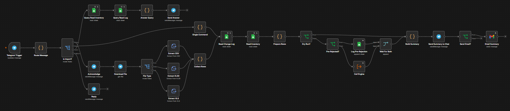
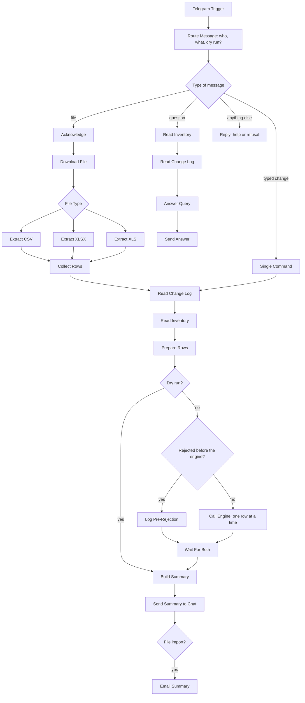
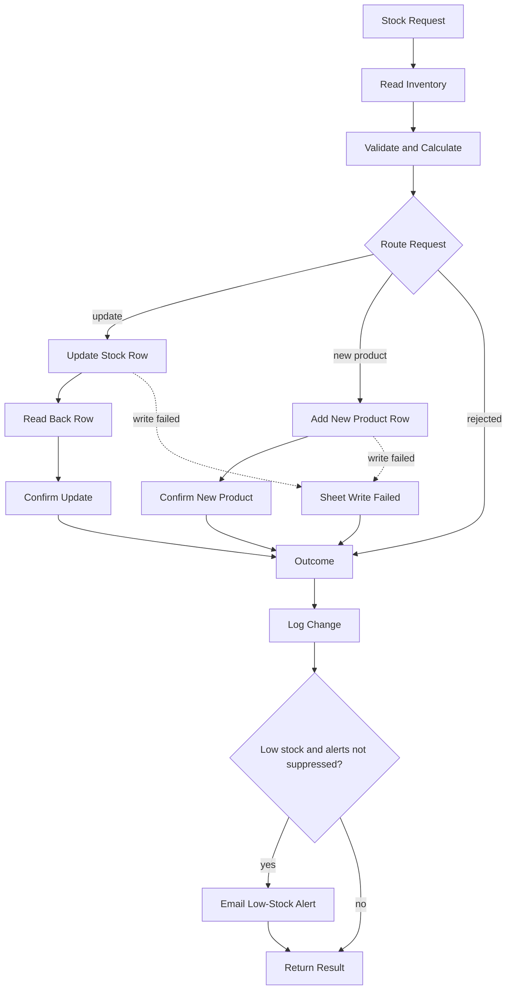

# Architecture

## Overview

Two n8n workflows with one clear division of labour.

| Workflow | Role |
|---|---|
| **Bulk Inventory Import (Telegram)** | Receives messages and files, checks who is asking, reads and prepares rows, answers questions, runs dry runs, reports results |
| **Inventory Stock Update Engine** | The only thing that writes stock. Validates, updates the sheet, confirms the write, logs, alerts |

Keeping the engine separate means every change, from a typed message or a file row, goes through the same checks and the same audit trail.

## Front-door workflow

As built in n8n:

The same flow as a diagram:

## Engine workflow

As built in n8n:

The same flow as a diagram:

## Key design decisions

**Reuse the engine instead of duplicating its logic.** The front door never writes stock. One set of rules, one audit trail.

**Rows are sent to the engine one at a time.** Product IDs are generated from the current maximum, so parallel writes could collide. Sequential processing avoids this.

**Dry run is a simulation inside the front door.** It keeps a working copy of the inventory and applies each row to it in order, so later rows see the effect of earlier ones. It writes nothing. Because the real checks live in the engine, a dry run is a prediction, not a guarantee.

**Name lookup resolves to a Product ID before the engine is called.** Exact, case-insensitive match. Unknown or ambiguous names are rejected with suggestions and logged.

**Request IDs give idempotency.** A Request ID that already succeeded is refused. Typed commands use the Telegram update ID, so a re-delivered message cannot apply twice, while repeating the same command in a new message is a new change. Rejected rows can be retried with the same ID.

**Alert noise control.** File imports pass `suppress_alert` to the engine and the low-stock products are listed once in the summary. Typed changes keep the normal alert.

**Access control at the door.** The chat ID is checked against an allowlist before anything else. `/myid` is the only command that works for everyone.

**Read-only questions never touch the engine.** They read the Inventory and Change Log sheets and format an answer.

## Data

| Sheet | Purpose | Written by |
|---|---|---|
| Inventory | Current stock per product | Engine only |
| Inventory Change Log | Every attempt, successful or rejected | Engine, plus the front door for rows it rejects itself |

Column definitions are in [`templates/`](../templates).

## Known limits of the design

- Google Sheets is the data store. It suits small to mid-sized catalogues, not very high volume.
- Each file row is one engine execution, which counts towards the n8n plan's execution limit.
- Files are capped at 500 rows.
- Questions are matched by patterns, not language understanding.
